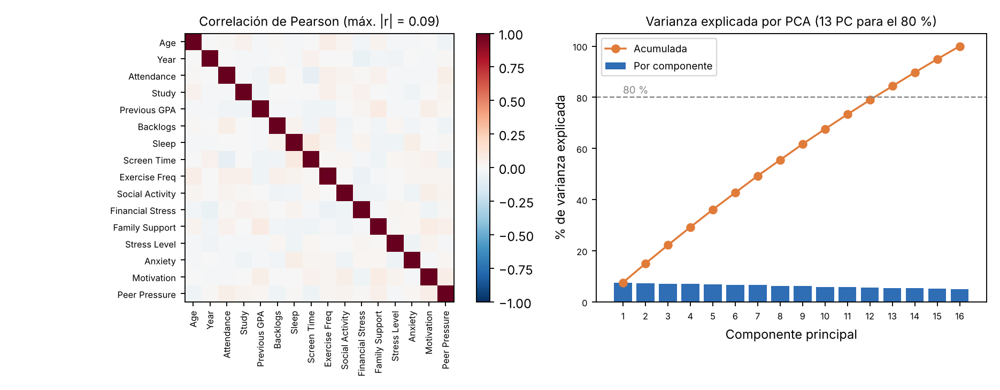
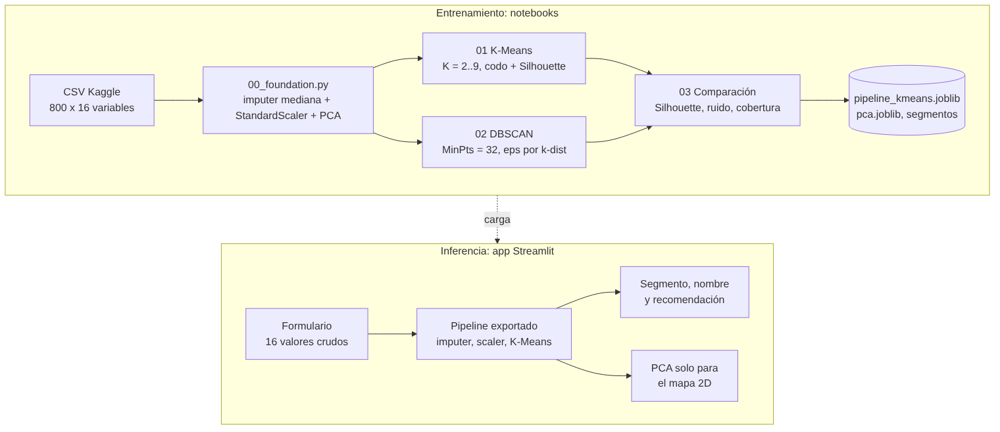
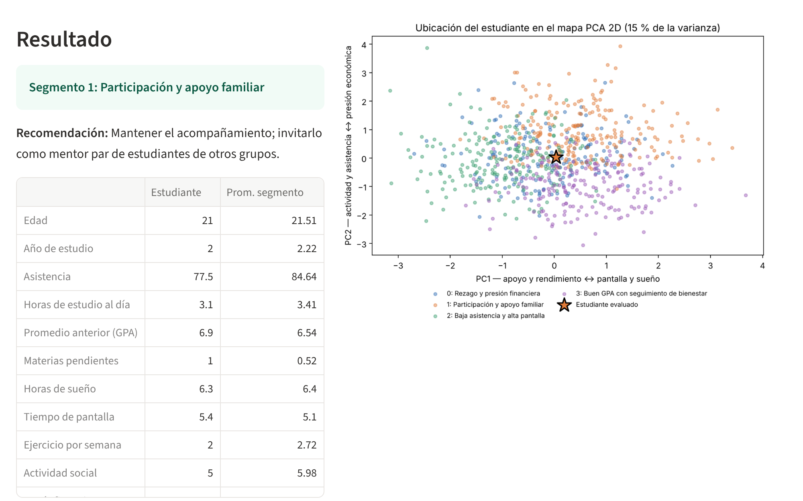
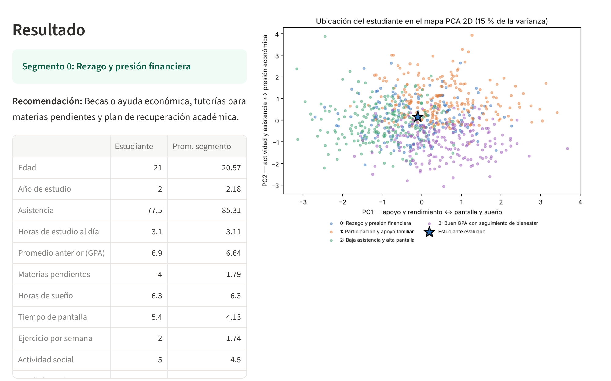

**Proyecto RDA2: Segmentación de Estudiantes con Clustering (K-Means y DBSCAN)**

Alejandro Flores, Paúl Rosero y Gloria Chushig

Inteligencia Artificial

10 de noviembre de 2026

**1. Introducción**

La deserción universitaria y el agotamiento académico (*burnout*) rara vez tienen una sola causa: se combinan el rendimiento, los hábitos y la situación emocional y económica de cada estudiante. Una institución con recursos limitados (becas, tutorías, consejería) necesita saber **qué grupos de estudiantes existen y qué acción necesita cada uno**.

Este proyecto segmenta a 800 estudiantes con **aprendizaje no supervisado**: los grupos se descubren solo a partir de la similitud entre estudiantes en 16 variables, sin usar ninguna etiqueta. Se construyeron y compararon dos algoritmos de scikit-learn, **K-Means** y **DBSCAN**, y el ganador (K-Means con K = 4) se desplegó en una aplicación web con Streamlit. La aplicación asigna a un estudiante nuevo a su segmento y le propone una acción concreta.

**2. Datos y análisis exploratorio**

Se utilizó el dataset *Student Burnout and Dropout* de Kaggle: 800 estudiantes y 25 columnas. Al modelo entran **16 variables numéricas**: edad, año de estudio, asistencia, horas de estudio, GPA previo, materias pendientes, sueño, tiempo de pantalla, ejercicio, actividad social, estrés financiero, apoyo familiar, estrés, ansiedad, motivación y presión de pares. El identificador y las variables categóricas de texto quedaron fuera. Las binarias (Part_Time_Job, Counseling_Access) solo se usan para interpretar los perfiles. Las etiquetas Burnout_Level y Dropout_Risk se excluyeron por completo: usarlas convertiría el problema en una clasificación. Durante la preparación se tomaron tres decisiones:

-   **Nulos:** 504 celdas faltantes en 13 variables (máximo 51 en Attendance_Percent). Se imputaron con la **mediana**, que no se mueve con los valores extremos, y no se eliminó a ningún estudiante.

-   **Atípicos:** el criterio de Tukey (1,5 · IQR) marca 73 de 12.800 celdas (0,57 %), sobre todo en Backlogs. Se conservaron porque son valores plausibles (un estudiante puede acumular varias materias pendientes) y no llegan al 1 % de los datos.

-   **Escalado:** StandardScaler deja cada variable con media 0 y desviación 1. Es obligatorio porque K-Means y DBSCAN deciden por distancia euclidiana; sin escalar, la asistencia (0–100) dominaría a las materias pendientes (0–5).

Ninguna correlación entre variables supera |r| = 0,09 (Figura 1, izquierda): no hay variables redundantes, pero tampoco una estructura de grupos evidente. En el **PCA**, PC1 explica 7,6 % de la varianza y PC2 7,4 % (15,0 % juntas), y hacen falta 13 componentes para llegar al 80 %. Por eso los modelos se entrenan en las 16 dimensiones originales y el PCA se usa **solo para visualizar**. Según sus *loadings*, PC1 contrapone apoyo y rendimiento (apoyo familiar 0,48; GPA 0,39) a hábitos de riesgo (pantalla −0,41; sueño −0,34). PC2 contrapone actividad y asistencia (ejercicio 0,56; asistencia 0,36) a presión económica (estrés financiero −0,29).

**Figura 1**

*Correlaciones entre las 16 variables (izquierda) y varianza explicada por componente principal (derecha)*

{width="5.8in"}

**3. Arquitectura de la solución**

Un script común, 00_foundation.py, carga los datos y ajusta la imputación, el escalado y el PCA con RANDOM_STATE = 42. Así **los dos modelos se entrenan con los mismos datos y el mismo preprocesamiento**. Cada modelo es un Pipeline de scikit-learn (SimpleImputer → StandardScaler → modelo), de modo que un registro nuevo recibe exactamente la misma transformación que los datos de entrenamiento. Los pipelines se exportan con joblib junto con los nombres de los segmentos.

El notebook 03_final.ipynb vuelve a entrenar ambos modelos y comprueba que producen **las mismas etiquetas, estudiante por estudiante**, que los artefactos guardados. Después los compara y elige el modelo final. K-Means tiene predict(); DBSCAN no, así que para él se implementó la regla vista en clase: buscar con NearestNeighbors el punto *core* más cercano y heredar su cluster si está a una distancia ≤ ε, o marcar el registro como ruido (−1) si no.

**Figura 2**

*Arquitectura de la solución: entrenamiento e inferencia*

{width="5.2in"}

**4. Modelado, comparación y selección del modelo**

Se entrenaron ambos modelos con el 100 % de los datos (en clustering no hay división entre entrenamiento y prueba). La Tabla 1 resume sus configuraciones y la Tabla 2, sus resultados.

**Tabla 1**

*Configuración de los modelos*

| **Modelo** | **Configuración final** | **Selección de hiperparámetros** | **Registros nuevos** |
|:---|:---|:---|:---|
| K-Means | K = 4, n_init = 10, random_state = 42 | Barrido de K = 2 a 9 con codo (inercia) y Silhouette | predict() |
| DBSCAN | MinPts = 32, ε = 3,2 | MinPts = 2·D (D = 16); ε con el gráfico k-dist y un barrido de 2,8 a 4,0 | NearestNeighbors sobre los puntos *core* |

**K-Means.** La inercia baja de 12.155 (K = 2) a 10.111 (K = 9). La reducción porcentual cae de 3,50 % (K = 3 → 4) a 2,73 % (K = 4 → 5), por lo que el codo aproximado está en **K = 4** (Figura 3, izquierda). El Silhouette es bajo y casi plano en todo el rango (0,046 a 0,050). K = 9 apenas lo mejora en 0,003 y daría nueve perfiles difíciles de atender.

**DBSCAN.** El gráfico k-dist (Figura 3, derecha) sube de forma gradual y no tiene un codo claro. Su curvatura está entre 4,5 y 5, pero con ε ≥ 3,3 todos los estudiantes densos se fusionan en un solo cluster, y con ε ≤ 3,1 todo es ruido. **ε = 3,2** es el único valor del barrido que produce más de un grupo.

**Figura 3**

*Método del codo de K-Means (izquierda) y gráfico k-dist de DBSCAN con k = 32 (derecha)*

{width="2.55in"} {width="2.75in"}

**Tabla 2**

*Resultados de los modelos con los 800 estudiantes*

| **Modelo** | **Clusters** | **Tamaños** | **Silhouette** | **Inercia** | **% ruido** | **Cobertura** |
|:---|:---:|:---|:---:|:---:|:---:|:---:|
| **K-Means** | **4** | 171 / 220 / 206 / 203 | 0,047 | 11.290,7 | **0 %** | **100 %** |
| DBSCAN | 2 | 65 / 31 (+ 704 ruido) | **0,134**\* | — | 88 % | 12 % |

*Nota.* \*Calculado sin los puntos de ruido (−1), es decir, sobre 96 estudiantes. Cobertura = % de estudiantes asignados a un cluster. En negrita, el mejor valor de cada columna.

En la Figura 4, K-Means reparte a todos los estudiantes en cuatro grupos que se solapan en el centro del mapa, lo esperable con un Silhouette cercano a 0. En DBSCAN, casi todo el mapa es gris: **704 de 800 estudiantes quedan como ruido**. En 16 dimensiones las distancias entre estudiantes se parecen demasiado (maldición de la dimensionalidad), así que casi nadie tiene 32 vecinos a menos de 3,2 unidades.

**Figura 4**

*Proyección PCA 2D de K-Means (izquierda) y de DBSCAN (derecha); en gris, el ruido de DBSCAN*

{width="2.7in"} {width="2.5in"}

**Modelo seleccionado: K-Means (K = 4).** DBSCAN tiene un Silhouette más alto (0,134 frente a 0,047), pero se calcula solo sobre el 12 % de los estudiantes. Para una institución que quiere actuar sobre toda su población, dejar sin perfil al 88 % no es aceptable. La regla, fijada antes de ver los resultados, penaliza a DBSCAN cuando su ruido supera el 20 %. K-Means cubre al 100 % con cuatro grupos de tamaño parecido, y cada grupo corresponde a una acción distinta (Tabla 3). Su costo es una separación débil: los segmentos son **tendencias para priorizar apoyo**, no diagnósticos individuales. Se exportó como models/pipeline_kmeans.joblib. La justificación completa está en informe/decision_modelo.md.

**Tabla 3**

*Perfil de cada segmento (promedios en escala original con groupby().mean()) y acción recomendada*

| **Segmento (n)** | **Rasgos que lo distinguen** | **Recomendación** |
|:---|:---|:---|
| **0. Rezago y presión financiera** (171) | Más materias pendientes (1,79) y más estrés (6,09); estrés financiero 5,65 | Becas o ayuda económica, tutorías y plan de recuperación |
| **1. Participación y apoyo familiar** (220) | Mayor apoyo familiar (7,33), motivación (6,06) y actividad social (5,98) | Mantener el acompañamiento; mentores pares de otros grupos |
| **2. Baja asistencia y alta pantalla** (206) | Más pantalla (6,72 h/día), asistencia 69,1 %, menor apoyo familiar (5,18) | Alertas de asistencia; talleres de hábitos y sueño |
| **3. Buen GPA con seguimiento de bienestar** (203) | Mejor GPA (7,64), pero mayor estrés financiero (5,93) y menor acceso a consejería (30,5 %) | Reconocimiento académico y consejería preventiva |

**5. Aplicación web**

La aplicación en Streamlit (app/app.py) muestra un formulario con las 16 variables **en su escala original**, con los rangos observados en el dataset. Al pulsar *Asignar segmento*, el pipeline exportado imputa, escala y asigna el segmento sin entrenar nada. La app muestra el número y el nombre del segmento, su recomendación y una tabla que compara al estudiante con el promedio de su grupo. Para el mapa 2D, el registro escalado se proyecta con models/pca.joblib y se dibuja como una estrella sobre los 800 estudiantes, coloreados por segmento. Como el modelo final es K-Means, todo registro recibe un segmento: no existe el caso de ruido.

**Figura 5**

*Resultados de la aplicación: con valores medianos, el estudiante cae en el segmento 1 (izquierda); con 4 materias pendientes y estrés de 8,5, pasa al segmento 0 (derecha)*

{width="2.65in"} {width="2.65in"}

**Limitaciones.** El Silhouette de 0,047 indica que los grupos se solapan: un estudiante cercano a la frontera puede cambiar de segmento con pequeñas variaciones en sus datos. El mapa 2D muestra solo el 15 % de la varianza, así que dos estudiantes cercanos en el mapa pueden estar lejos en las 16 dimensiones. Los puntajes de estrés, ansiedad y motivación son autodeclarados, y el dataset proviene de Kaggle, no de nuestra institución. Por eso el segmento debe usarse como un primer filtro para orientar el apoyo y confirmarse con consejería, nunca para sancionar o etiquetar a un estudiante.

**6. Instalación y ejecución local**

Requisitos: Python 3.11 o superior. Desde una terminal:

```
git clone https://github.com/alex171215/Proyecto-DBSCAN-KMeans-RDA2.git
cd Proyecto-DBSCAN-KMeans-RDA2
pip install -r app/requirements.txt
python -m streamlit run app/app.py
```

La app se abre en http://localhost:8501. Los modelos ya entrenados están en models/. Para regenerar todo desde cero se ejecuta python 00_foundation.py y luego los notebooks 01, 02 y 03 en orden. La versión scikit-learn==1.9.1 está fijada en requirements.txt para que los archivos .joblib carguen igual en cualquier equipo.

**7. Conclusiones**

-   **K-Means (K = 4)** fue el modelo seleccionado: cubre al 100 % de los estudiantes con cuatro perfiles accionables, frente al 12 % de DBSCAN.

-   **DBSCAN** no es adecuado para este dataset: en 16 dimensiones la densidad pierde contraste y el 88 % de los estudiantes queda como ruido. Su Silhouette más alto no es comparable, porque excluye a la mayoría.

-   La **calidad de la separación es baja** en ambos modelos (Silhouette ≤ 0,134), coherente con variables casi sin correlación entre sí. Una métrica sola no basta: la decisión se tomó combinando Silhouette, cobertura y utilidad para el negocio.

-   Como trabajo futuro se propone añadir variables con más poder de separación (historial de notas por semestre, uso de servicios universitarios) y probar métodos más robustos en alta dimensión, como HDBSCAN o reducir dimensiones con PCA antes de DBSCAN.

**Referencias**

Ester, M., Kriegel, H.-P., Sander, J., & Xu, X. (1996). A density-based algorithm for discovering clusters in large spatial databases with noise. En *Proceedings of the Second International Conference on Knowledge Discovery and Data Mining* (pp. 226–231). AAAI Press.

[Autor del dataset]. (s.f.). *Student Burnout and Dropout* \[Conjunto de datos\]. Kaggle. [enlace del dataset en Kaggle]

Pedregosa, F., Varoquaux, G., Gramfort, A., Michel, V., Thirion, B., Grisel, O., ... Duchesnay, É. (2011). Scikit-learn: Machine learning in Python. *Journal of Machine Learning Research, 12*, 2825–2830.

Rousseeuw, P. J. (1987). Silhouettes: A graphical aid to the interpretation and validation of cluster analysis. *Journal of Computational and Applied Mathematics, 20*, 53–65.
